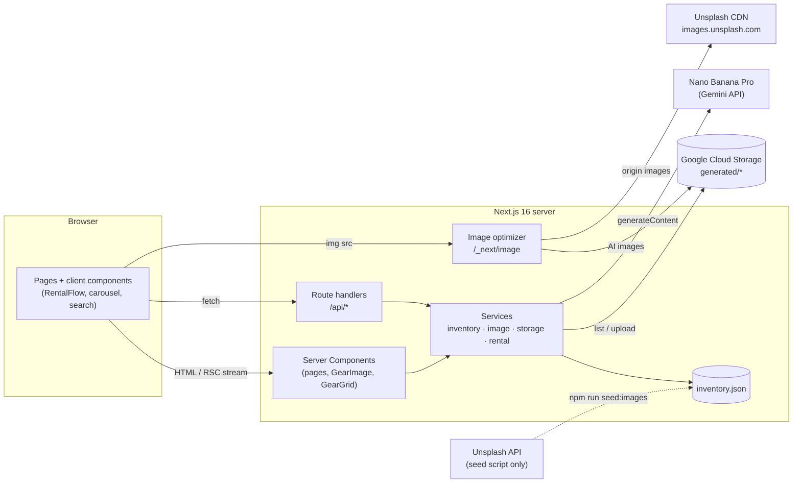
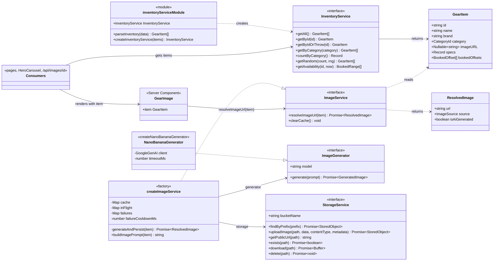
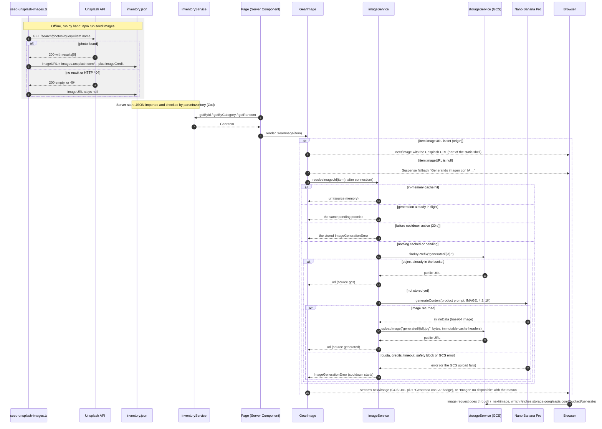
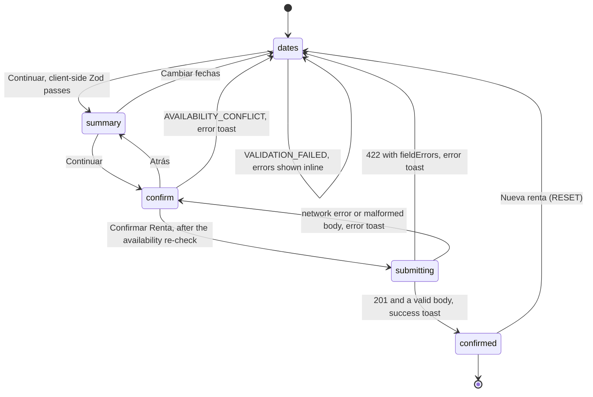
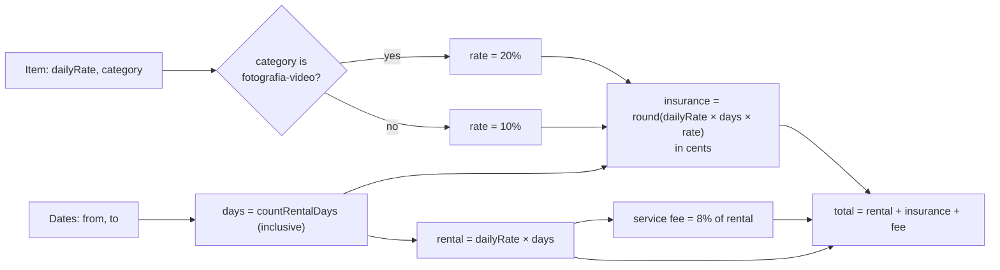

# Architecture

This document explains how Rent my Gear works: how pages are rendered, how data moves through the services,
how an item's image is found or generated, and how a rental is validated and confirmed. For setting up the
project and day-to-day work, read the [Onboarding Guide](ONBOARDING.md). For the HTTP endpoints, see the
[API reference](API.md).

## Contents

1. [System overview](#1-system-overview)
2. [Tech stack](#2-tech-stack)
3. [Repository layout](#3-repository-layout)
4. [Rendering model](#4-rendering-model)
5. [Domain model](#5-domain-model)
6. [Services](#6-services)
7. [Image resolution flow](#7-image-resolution-flow)
8. [Rental flow](#8-rental-flow)
9. [Validation](#9-validation)
10. [Errors, boundaries and logging](#10-errors-boundaries-and-logging)
11. [Configuration](#11-configuration)
12. [Design decisions and known limitations](#12-design-decisions-and-known-limitations)

## 1. System overview

Rent my Gear is a marketplace for renting premium equipment. The UI is in Spanish and the code is in English.

- **Catalog.** 50 items in three categories: *Fotografía y Video*, *Montaña y Camping* and *Deportes
  Acuáticos*. The catalog is a JSON file, `src/data/inventory.json`, validated with Zod when the server loads
  it. There is no database.
- **Smart Insurance.** Every rental includes insurance: 20% of the rental for photography and video equipment,
  10% for everything else. See [Smart Insurance](#smart-insurance-srclibinsurancets).
- **Booking.** A three-step wizard: dates → price summary → confirmation. It ends at a **mock** booking API
  that validates the request and recalculates the price on the server, but saves nothing. Each item's
  availability comes from booked windows stored as offsets from "today", so the demo data never goes out of
  date.
- **Images.** Items get a photo from Unsplash ahead of time, through a seed script. When an item has no
  photo, the server generates one with **Nano Banana Pro** (Gemini 3 Pro Image) and saves it to **Google Cloud
  Storage**. The saved image is reused from then on.
- There is no authentication and no payment. Everything else (validation, error states, logging) is built
  as it would be for production.



## 2. Tech stack

| Concern | Choice | Notes |
|---|---|---|
| Framework | **Next.js 16.4** (App Router, Turbopack) | `cacheComponents` + `partialPrefetching` turned on: Partial Prerendering (PPR) is the default. |
| UI runtime | React 19.3 | Server Components by default; client components only where they are needed. |
| Styling | Tailwind CSS v4, shadcn/ui (`new-york` style, Radix primitives), lucide icons | The generated shadcn components are in `src/components/ui`. |
| Validation | **Zod 4** | Used for environment variables, inventory data, rental requests and API responses. |
| Dates | date-fns 4 (Spanish locale), react-day-picker 10 | Everything works in local calendar days. |
| Carousel / toasts | Embla (with autoplay), sonner | |
| Images | `@google/genai` (Nano Banana Pro), `@google-cloud/storage`, `next/image` | |
| Tests | Vitest 5, React Testing Library, jsdom | See [TESTING.md](TESTING.md). |
| Tooling | TypeScript 5 (strict), ESLint 9 (`eslint-config-next`), `tsx` for scripts, `uv` for the Python GCS setup | |

## 3. Repository layout

```text
.
├── setup_gcs.py                 # Creates and checks the GCS bucket (uv run; PEP 723 inline deps)
├── scripts/
│   ├── seed-unsplash-images.ts  # CLI: fills imageURL in inventory.json from Unsplash
│   └── unsplash.ts              # Testable Unsplash search and seeding logic
├── src/
│   ├── instrumentation.ts       # Runs once at server start: environment check, request error logging
│   ├── instrumentation-node.ts  # Node-only start-up check (exits the process if the config is invalid)
│   ├── app/                     # Routes (App Router)
│   │   ├── layout.tsx           # <html lang="es">, header, footer, <Toaster>
│   │   ├── page.tsx             # "/"  — home page (its errors go to app/error.tsx)
│   │   ├── category/[id]/       # "/category/:id"
│   │   ├── gear/[id]/           # "/gear/:id"  — detail page + RentalFlow
│   │   ├── api/                 # health, images/[id], availability/[id], rentals
│   │   ├── error.tsx, global-error.tsx, not-found.tsx
│   ├── components/
│   │   ├── features/            # Domain UI: GearImage, HeroCarousel, GearGrid, CategoryButtons, RentalFlow/
│   │   ├── layout/              # SiteHeader, MainNav, SiteFooter
│   │   ├── shared/              # ErrorState (shared fallback for error boundaries)
│   │   └── ui/                  # shadcn/ui components (generated; keep edits small)
│   ├── config/
│   │   ├── env.ts               # Zod environment schema, getEnv()
│   │   └── categories.ts        # Labels, copy and image-prompt context for each category
│   ├── data/inventory.json      # The catalog (50 items)
│   ├── lib/                     # Pure helpers: insurance, date-utils (pricing), validation, errors, logger, image-failure
│   ├── services/                # inventory, image, storage, rental (factories + singletons)
│   ├── types/gear.ts            # Zod schemas and domain types (GearItem, CategoryId, ResolvedImage…)
│   └── __tests__/               # Vitest + RTL: unit/, integration/, edge-cases/, setup.ts
├── vitest.config.mts            # jsdom, coverage scope and the 100% thresholds
├── docs/                        # This documentation
└── credentials/                 # Service-account key (git-ignored)
```

## 4. Rendering model

`next.config.ts` sets `cacheComponents: true`, so every route uses **Partial Prerendering (PPR)**.

- **The static shell.** Everything that doesn't depend on the request (layout, headings, specs, prices) is
  rendered at build time and served instantly.
- **Dynamic parts stream in.** Anything that depends on the request, or on "now", must:
  1. sit inside a `<Suspense>` boundary, and
  2. call `await connection()` from `next/server` before doing that work.

  `Math.random()`, `new Date()`, uncached I/O, Gemini calls and GCS calls all count. Without `connection()`,
  the value would be frozen into the shell at build time, or the build would fail.

| Route | Static shell | Streamed at request time | Why it is dynamic |
|---|---|---|---|
| `/` | Hero copy, category tiles (with item counts), rates and Smart Insurance per category (`CategoryRates`), highlights | `HeroCarousel` | It picks 5 random items per request. |
| `/category/[id]` | Category header and navigation (3 pages from `generateStaticParams`) | `GearGrid` | `GearGridSearch` reads the URL's search params. |
| `/gear/[id]` | Image (when it has an `imageURL`), name, specs, daily rate, deposit (50 pages) | `AvailabilityBadge`, `RentalPanel` (`RentalFlow`) | Both depend on "today" and on the booked ranges. |
| Any page | — | `GearImage` for an item with `imageURL: null` | It runs image generation and GCS lookups. |

### Server and client components

Components are Server Components unless they need state, effects or browser APIs. The client components are:

- `RentalFlow` and its steps, plus the `useAvailability` hook
- `HeroCarouselClient` (Embla autoplay)
- `GearGridSearch` (filtering as you type)
- `MainNav`
- the error boundaries (`ImageErrorBoundary`, every `error.tsx`, `ErrorState`)
- a few shadcn components

Server-rendered content is passed into client components as props. Two examples:

- `GearGrid` (server) renders every card and hands the finished cards to `GearGridSearch` (client), which only
  shows or hides them.
- `HeroCarousel` (server) renders each slide's `<GearImage>` and gives the slides to `HeroCarouselClient`.

This keeps image resolution and the Google SDKs on the server.

### Hydration rule

A client component's first render must give the same output on the server and in the browser. Never compute
`Math.random()`, `Date.now()` or a locale-dependent string during that first render. For example, the calendar
formats `data-day` with a fixed `yyyy-MM-dd` pattern instead of `toLocaleDateString`. Values that have to vary
are computed on the server (after `connection()`) and passed in as props. `HeroCarousel` picks its random items
that way.

## 5. Domain model

Source: `src/types/gear.ts`. These Zod schemas are the single definition of each type: the TypeScript types are
inferred from them with `z.infer`.

| Type | Fields / meaning |
|---|---|
| `CategoryId` | `"fotografia-video" \| "montana-camping" \| "deportes-acuaticos"`. A Zod enum built from `CATEGORY_IDS`. |
| `GearItem` | `id` (lowercase slug), `name`, `brand`, `category`, `tagline`, `description`, `dailyRate` (USD), `deposit`, `rating` (0–5), `reviewCount`, `location`, `specs` (label → value), `imageURL` (URL or `null`), `imageCredit` (Unsplash attribution or `null`), `bookedOffsets`. |
| `BookedOffset` | `{ startInDays ≥ 0, lengthDays ≥ 1 }`, relative to *today*. Converted to real dates at request time by `resolveBookedRanges`. |
| `BookedRange` / `BookedRangeISO` | An inclusive `{ from, to }` pair, as `Date`s on the server and as ISO strings when sent to the browser. |
| `ResolvedImage` | `{ url, source: "origin" \| "memory" \| "gcs" \| "generated", isAiGenerated }`. |
| `Category` (`src/config/categories.ts`) | `id`, `name`, `tagline`, `description`, `imagePromptContext` (steers the style of the generated photos). |

Money is in USD, shown with the `es-US` locale (`formatCurrency`). Prices are calculated in integer cents.

## 6. Services

All services follow the same pattern:

- **Factory.** `createXService(deps)` builds the service from its dependencies, so tests can pass fakes.
- **Default instance.** Each module also exports one shared instance wired to real dependencies:
  `inventoryService` is created when the module loads, while `getImageService()` and `getStorageService()`
  create theirs on first use.
- **Server-side by use, not by guard.** Services are only imported from Server Components and route
  handlers, and `env` and `storage` depend on Node APIs (`fs`, the GCS SDK) that a browser build rejects.
  They deliberately don't import the `server-only` package. That package throws outside Next.js's server
  bundle, which stopped the root page from rendering in a plain Vitest environment, which is how the automatic
  grader loads it.
- **Relative imports.** Code under `src/` imports with relative paths instead of the `@/` alias, for the same
  reason: a test runner without path-alias configuration can still load any module.

| Service | Responsibility | Depends on |
|---|---|---|
| `inventoryService` | Loads `inventory.json`, validates it with Zod (`parseInventory`), and answers queries: by id, by category, counts, random picks, availability. | `InventorySchema`, `resolveBookedRanges` |
| `imageService` | Resolves an item's image URL: origin → memory → GCS → generate with Nano Banana. | `StorageService`, `ImageGenerator`, `CATEGORIES` |
| `storageService` | Thin GCS wrapper: `findByPrefix`, `uploadImage`, `exists`, `download`, `delete`, `getPublicUrl`. Errors are wrapped in `StorageError`. | `@google-cloud/storage`, `getEnv()` |
| `rentalService` | Mock booking: checks the item exists, validates the request against that item's availability, recalculates the price, returns a confirmation code. | `inventoryService`, `createRentalRequestSchema`, `calculateRentalPrice` |

### inventoryService and imageService

The two services **don't call each other**. A consumer gets a `GearItem` from `inventoryService` and passes
it to `imageService.resolveImageUrl(item)`. The consumer is a page, `HeroCarousel` or the `/api/images/[id]`
route. `GearImage` is the component that does the hand-off during rendering.



## 7. Image resolution flow

An item's image comes from one of two places:

- **An origin image**: an Unsplash URL written into `inventory.json` ahead of time by `npm run seed:images`.
- **An AI image**: generated by Nano Banana the first time someone requests it, then stored in GCS under
  `generated/<itemId>.<ext>` and reused from then on.

Today, 24 items have Unsplash photos and 26 rely on Nano Banana. 8 of those 26 are deliberate (`AI_ONLY_IDS`
in `scripts/unsplash.ts`); the other 18 had no Unsplash result.



### Resolution order (`imageService.resolveImageUrl`)

| # | Check | `source` | Cost |
|---|---|---|---|
| 1 | `item.imageURL` is set | `origin` | None. `GearImage` renders it directly and doesn't call the service. |
| 2 | In-memory cache (a `Map` on `globalThis`, so it survives hot reloads in dev) | `memory` | None |
| 3 | A request for the same item is already in progress | (same as that request) | Shares the pending promise, so it never generates twice. |
| 4 | The item failed less than 30 s ago | — | Throws the stored error without calling Gemini or GCS. |
| 5 | An object matching `generated/<id>.` exists in GCS | `gcs` | One list request. This step is what keeps an image saved across restarts. |
| 6 | Generate with Nano Banana and upload to GCS | `generated` | About 10–20 s plus one upload. Happens once per item. |

**How a generated image is stored.**
- **Path:** `generated/<itemId>.<ext>`. The extension follows the type Gemini returns: `.png`, `.jpg` or `.webp`. Nano Banana Pro currently returns JPEG, so the stored files are `.jpg`.
- **Cache headers:** `Cache-Control: public, max-age=31536000, immutable`.
- **Custom metadata:** `itemId`, `model` and `generatedAt`.
- **Access:** the bucket is publicly readable (`allUsers` has `roles/storage.objectViewer`), so `next/image` can
  fetch images by URL.
- **Allowed hosts:** `next.config.ts` lists `images.unsplash.com` and `storage.googleapis.com/<bucket>/**` in
  `images.remotePatterns`.

**The prompt.** `buildImagePrompt` combines brand, name, the category's `imagePromptContext`, the tagline and
the first four specs into a studio product-photo prompt (no text, no people). The adapter asks for
`responseModalities: ["IMAGE"]`, a 4:3 aspect ratio and 1K size, and allows 120 s before timing out.

### When generation fails

- **Expected failures are shown as a message.** Quota (429), depleted credits (402), an invalid key (400/401),
  a timeout, a safety block or a GCS error arrive as `ImageGenerationError`, with the provider's details
  (`parseProviderError`). `GearImage` renders them **on the server** as **"Imagen no disponible"**, made of:
  - a Spanish reason
  - "Intenta de nuevo en ~N min" when Gemini's `RetryInfo` says how long to wait
  - a short technical tag, for example `Gemini HTTP 429 · RESOURCE_EXHAUSTED`

  `describeImageFailure` in `src/lib/image-failure.ts` builds this. It runs on the server because production
  builds hide error-boundary messages.
- **Anything else** reaches `ImageErrorBoundary`, built with `catchError` from `next/error`. It shows a
  *Reintentar* button. The boundary is per image, so the rest of the page keeps working.
- **Retries wait 30 s.** For 30 s after a failure, that item isn't retried on new renders.
  `GET /api/images/<id>?fresh` clears the cooldowns and the in-memory cache.

## 8. Rental flow

`RentalFlow` (client) is a `useReducer` state machine. The reducer, `rentalFlowReducer`, is a pure function
exported on its own so it can be tested.



(`submitting` isn't a separate step. It is `state.submitting = true` while the confirmation step is showing.)

**What happens when you click "Confirmar Renta":**

1. `useAvailability.refresh()` fetches the latest booked ranges from `GET /api/availability/[id]`.
   - If the selected range now overlaps a booking, the flow returns to the date step and no booking is sent.
   - The hook also refreshes every 30 s and whenever the window regains focus.
2. `POST /api/rentals` sends `{ itemId, from, to }`, with the dates as `yyyy-MM-dd` (`toDateOnly`).
3. The server validates the request again with **the same schema factory**, using the server's own clock and
   that item's booked ranges. It then **recalculates the price**; it never trusts a total from the browser.
4. The browser checks the response with `RentalConfirmationSchema` before showing the confirmation.

Every way out of `SUBMIT` dispatches either `SUBMIT_SUCCEEDED` or `SUBMIT_FAILED`. That guarantee is what
keeps the button from staying stuck on "Confirmando…".

### Date and price rules (`src/lib/date-utils.ts`)

- **Calendar days.** Dates are compared as local calendar days (`startOfDay`). A date leaves the browser only
  as a `yyyy-MM-dd` string, so time zones can shift nothing.
- **Days are counted inclusively** (`countRentalDays`). Picking up and returning on the same day counts as one
  day, and Jun 10 → Jun 12 is three days.
- **The price** is the rental (`dailyRate × days`), plus Smart Insurance (below), plus an 8% service fee on
  the rental. Everything is computed in integer cents. The refundable deposit is shown separately and isn't
  included in the total.
- **Limits.** At most 30 days (`MAX_RENTAL_DAYS`), no past dates, and no overlap with a booked range. Both
  ends of a booked range count as booked.

### Smart Insurance (`src/lib/insurance.ts`)

Every rental includes insurance, priced by category: photography and video equipment is riskier to rent.

| Category | Rate | Example: 3 days |
|---|---|---|
| `fotografia-video` | **20%** of the rental (`PHOTOGRAPHY_INSURANCE_RATE`) | Sony A7 IV at $65/day: $195 + **$39** insurance + $15.60 fee = **$249.60** |
| Every other category | **10%** (`DEFAULT_INSURANCE_RATE`) | Starboard Touring at $45/day: $135 + **$13.50** insurance + $10.80 fee = **$159.30** |

- `getInsuranceRate(category)` returns the rate. It accepts the app's ids (`fotografia-video`) and plain
  names in English or Spanish (`"photography"`, `"Fotografía y Video"`). Any other category, including a new
  one, gets 10%.
- `calculateInsurance(category, dailyRate, days = 1)` returns rate × daily rate × days, rounded to whole
  cents.
  It throws a `RangeError` for a negative or non-finite rate, or for days that aren't a positive whole
  number.
- `calculateRentalPrice({ dailyRate, deposit, category }, from, to)` adds it as its own line item, "Seguro
  inteligente (20%)", and to `total`. The 8% service fee is charged on the rental only, never on the
  insurance.
- The server recalculates insurance in `POST /api/rentals` and returns it as `insurance` in the
  confirmation. Any amount sent by the browser is ignored.
- **Where users see it:**
  - the home page: the "Seguro inteligente" highlight, and the rate on each category card
  - the item page: "Seguro inteligente: 20% de la tarifa ($13.00 / día)"
  - the price summary and confirmation steps
  - the confirmed screen: "Incluye seguro inteligente"



## 9. Validation

Zod checks data wherever it enters the system, and each check fails with a message that points at the
cause.

| Boundary | Schema | When it runs | On failure |
|---|---|---|---|
| Environment | `envSchema` (`src/config/env.ts`) | Once, in `instrumentation.ts`, before the server accepts requests | Prints a report per variable, with hints, and **exits the process** |
| Catalog | `InventorySchema` (`src/types/gear.ts`) | When `inventoryService` loads | `InventoryValidationError` with the path, for example `[3.category]` |
| Rental request | `createRentalRequestSchema({ now, bookedRanges })` | Browser (on Continuar) and server (`POST /api/rentals`) | Inline field errors / HTTP 422 with `fieldErrors` |
| Booking API response | `RentalConfirmationSchema` | Browser, before showing the confirmation | Error toast, no confirmation shown |

`createRentalRequestSchema` accepts an injectable clock (`now`) and an item's booked ranges, so the same rules
run in the browser, on the server and in tests.

## 10. Errors, boundaries and logging

**Typed errors** (`src/lib/errors.ts`). Every error extends `AppError`, which carries a stable `code` and
optional `details` and `cause`:

| Class | `code` | Typical cause |
|---|---|---|
| `EnvValidationError` | `ENV_INVALID` | Missing or invalid environment variables |
| `InventoryValidationError` | `INVENTORY_INVALID` | Bad data in `inventory.json` |
| `NotFoundError` | `NOT_FOUND` | Unknown item id |
| `ImageGenerationError` | `IMAGE_GENERATION_FAILED` | Gemini failure, or any failure while resolving an image |
| `StorageError` | `STORAGE_FAILED` | GCS call failed (includes the operation, path and bucket) |
| `RentalValidationError` | `RENTAL_INVALID` | The rental request failed server-side validation |

`serializeError` turns an error and its `cause` chain into data that is safe to log. Stack traces are omitted
in production.

**Error boundaries**, from broadest to narrowest:

- `global-error.tsx` replaces the whole document.
- `app/error.tsx` (covers the home page) and the `error.tsx` of the category and gear routes show `ErrorState` with a retry button.
- `SectionErrorBoundary` (`name="hero"`) wraps the home carousel. A carousel failure removes only the
  carousel instead of unmounting the whole page.
- `ImageErrorBoundary` covers a single image.
- `not-found.tsx` handles unknown categories and items, through `notFound()`.

**Logging** (`src/lib/logger.ts`):

- **Usage:** `logger.child("imageService")` creates a logger whose lines are tagged `app:imageService`.
- **Format:** readable lines in development, for example `[INFO ] [app:imageService] AI image generated and
  persisted {…}`, and one JSON object per line in production.
- **Level:** `LOG_LEVEL` sets it. The default is `debug` in development and `info` in production.
- **Unhandled errors:** `onRequestError` in `instrumentation.ts` logs them with the route and the digest.

## 11. Configuration

The environment is validated by `src/config/env.ts`. A template is in `.env.example`; copy it to
`.env.local`, which git ignores.

| Variable | Required | Rules | Used by |
|---|---|---|---|
| `GCS_BUCKET_NAME` | yes | 3–63 chars: lowercase letters, digits, `.`, `_`, `-` | `storageService`, `next.config.ts` (allowed image hosts), `setup_gcs.py` |
| `GCS_PROJECT_ID` | yes | A GCP project **ID** (6–30 chars, starts with a letter) | `storageService`, `setup_gcs.py` |
| `GOOGLE_APPLICATION_CREDENTIALS` | yes | Path to a `.json` file that **exists** and is a service-account key | `storageService`, `setup_gcs.py` |
| `NANO_BANANA_API_KEY` | yes | Gemini API key, at least 20 chars, no spaces | Nano Banana adapter |
| `NANO_BANANA_MODEL` | no | Default `gemini-3-pro-image-preview` | Nano Banana adapter |
| `LOG_LEVEL` | no | `debug` \| `info` \| `warn` \| `error` | logger |
| `GCS_LOCATION` | no | Bucket location when `setup_gcs.py` creates it (default `US`) | `setup_gcs.py` |
| `UNSPLASH_ACCESS_KEY` | seed only | Not part of the runtime schema | `npm run seed:images` |

## 12. Design decisions and known limitations

- **Only AI images are stored in GCS.** Unsplash photos are served from Unsplash's CDN and never copied to the
  bucket.
- **Image URLs are not re-checked.** If an Unsplash photo is deleted after seeding, its saved URL returns a
  404 and users see a broken image; Nano Banana is not used. The fallback only applies to items with no
  `imageURL` at all. See [TESTING.md › Limitations](TESTING.md#limitations).
- **Failed images show a message; there is no automatic retry with back-off.** The 30 s cooldown only stops
  Gemini and GCS from being called on every render.
- **Bookings are mocked.** Confirmations are not saved, so the same dates can be booked twice. Availability
  comes from the relative offsets in `inventory.json`.
- **The in-memory cache belongs to one server process.** Several instances would each look up GCS once per
  item. That is fine, because GCS is the shared source of truth.
- **Server Components that are `async`** (pages, `GearImage`) can't be rendered by Vitest. They are covered by
  the integration test's route table, and by manual or E2E checks.
